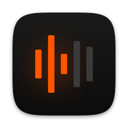
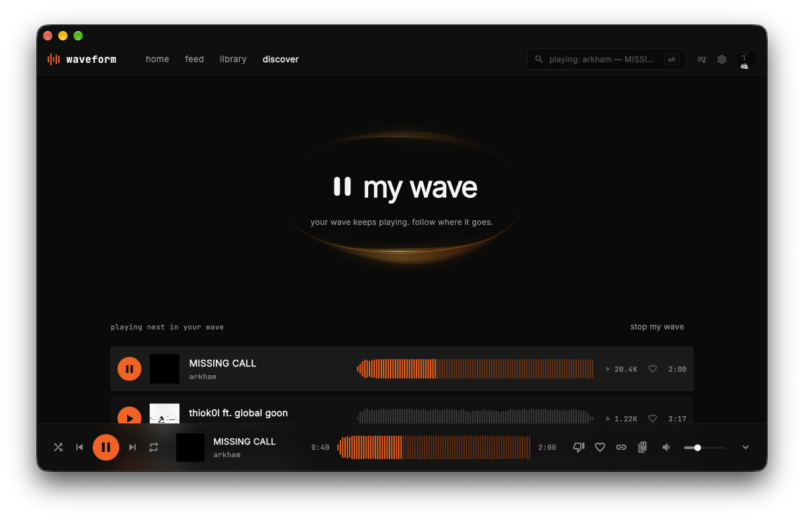

  

<h1 align="center">waveform</h1>

a keyboard-first soundcloud client for desktop flutter, macos / windows / linux

  
  
  
  
  

  

web soundcloud is fine, tabs are not

desktop clients for it either don't exist or they're electron wrapped around the website. so i made a real native one, closer to canonical soundcloud than other unofficial clients but darker and quieter, and you can run it for hours without touching the trackpad

> **v0.4.0:** my wave
>
> one button, an endless queue of real soundcloud tracks. it's built on your machine from your likes, your home stream and people with similar taste, and refills while it plays. no settings, no model, nothing sent anywhere but soundcloud itself
>
> also: drm-protected tracks from distributors and labels play on macos through a small go core that decrypts widevine streams over `dart:ffi` (go+ tracks still need a go+ subscription; the macos release bundles a device profile, from source you bring your own, see [limitations](docs/limitations.md)). plus an audio output picker with airplay, keyboard focus everywhere, reduced motion, a new icon, and web3 bits are gone for good
>
> daily-driver loop works on macos, windows and linux build too but i test them less. the api is unofficial so rough edges stay. everything else in [`CHANGELOG.md`](CHANGELOG.md)

  

### how my wave works

open **discover** in the top bar and press **play my wave** (you need to be signed in). each batch mixes three sources:

- **related** (half): tracks related to what you're playing, your newest likes and recent plays, ranked by a small local graph that learns from what you finish, skip and dislike
- **your stream** (a quarter): fresh uploads and reposts from people you follow
- **co-likers** (a quarter): people who liked the same tracks as you, and what else they liked. a background job, cached for a day, never stores their ids

tracks you can't play are dropped before they reach the queue, and the wave keeps going after the batch ends. thumbs down skips and teaches it, stop my wave hands the player back. details and the pilots behind it in [docs/my-wave.md](docs/my-wave.md)

## what you get

- **keyboard first.** space plays, ⌘K finds anything, arrows seek, ⇧ + arrows skip. enter on a track page plays it
- **gapless + crossfade 0-6 s.** the next track preloads on a second engine and swaps in on the last sample
- **media keys.** control center and media keys on macos. windows and linux aren't wired yet, see [limitations](docs/limitations.md)
- **my wave.** a nonstop queue of real soundcloud tracks picked on your device, see [above](#how-my-wave-works)
- **audio output.** pick a core audio device or airplay from the player, macos only. see [audio output](docs/audio-output.md)
- **your account.** you sign in on soundcloud's own page in a webview, the app never sees your password
- **last.fm.** off until you connect it
- **local stats.** top artists, genres and hours from your last 400 plays, counted on your machine

  

## install

builds are attached to every [github release](https://github.com/mollykitten/waveform/releases/latest). test builds and news go to telegram first: **[t.me/waveformsc](https://t.me/waveformsc)**

- **macos** (12+): grab the `.dmg`, drag into applications. signed and notarized
- **windows:** grab the `.zip`, run `Waveform.exe`. smartscreen asks once (no ev cert yet)
- **linux:** grab the `.tar.gz`, run `./waveform_app`

then sign in via settings → account. details in [docs/install.md](docs/install.md)

## docs

| | |
|---|---|
| [keyboard](docs/keyboard.md) | the daily loop and every shortcut |
| [usage](docs/usage.md) | how i use it |
| [features](docs/features.md) | what works today |
| [data and auth](docs/data-and-auth.md) | api-v2, sign-in, token storage |
| [limitations](docs/limitations.md) | drm, best-effort writes, platform gaps |
| [roadmap](docs/roadmap.md) | what's next |
| [design](docs/design.md) | palette, type, logo |
| [development](docs/development.md) | stack, layout, running from source |
| [releasing](docs/releasing.md) | ci secrets and cutting a tag |

## disclaimer

this is an **unofficial** client, **not affiliated with, endorsed by or connected to soundcloud**. it uses an undocumented internal api, and using that api may be against soundcloud's terms of service. it's for educational and personal use: use your own account, at your own risk. soundcloud, the soundcloud logo and related marks are trademarks of their owners

## license

[MIT](LICENSE)

the vendored [`third_party/desktop_webview_window`](third_party/desktop_webview_window) keeps its own [apache-2.0 license](third_party/desktop_webview_window/LICENSE). the license covers this code only and gives no rights to soundcloud's api, content or trademarks
